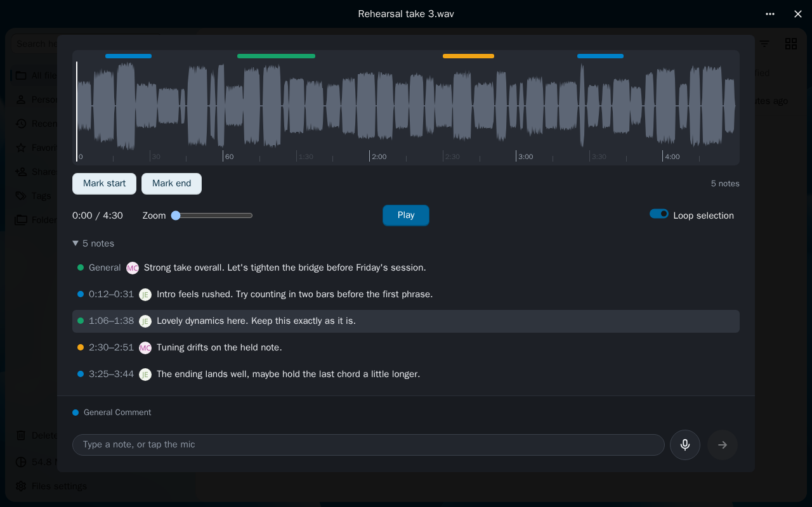
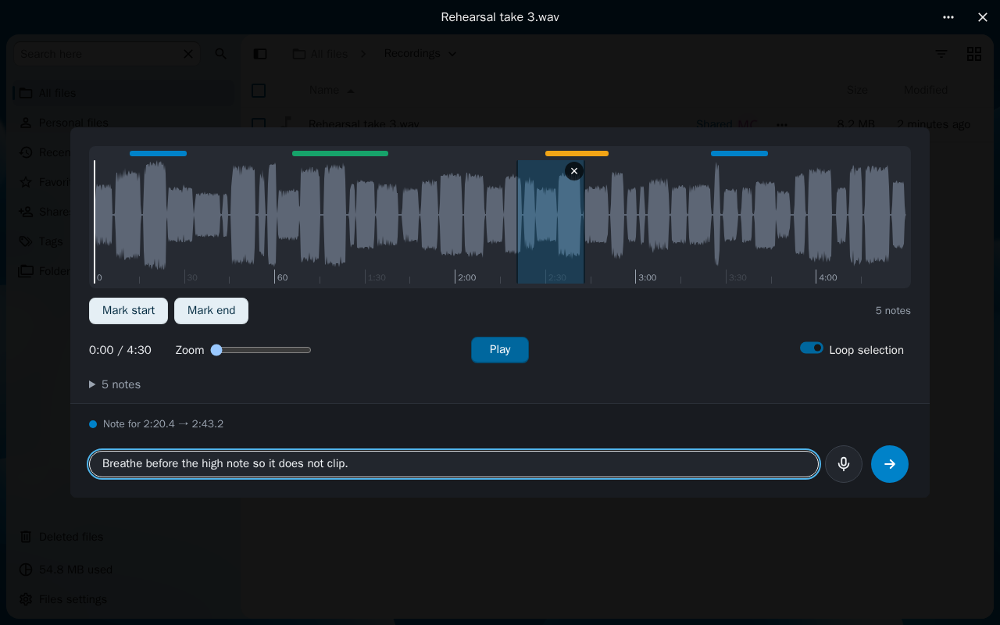
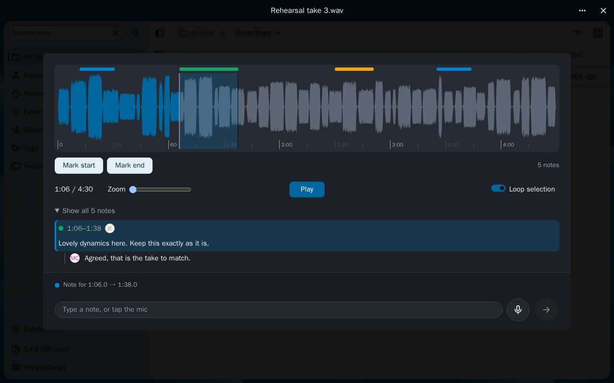
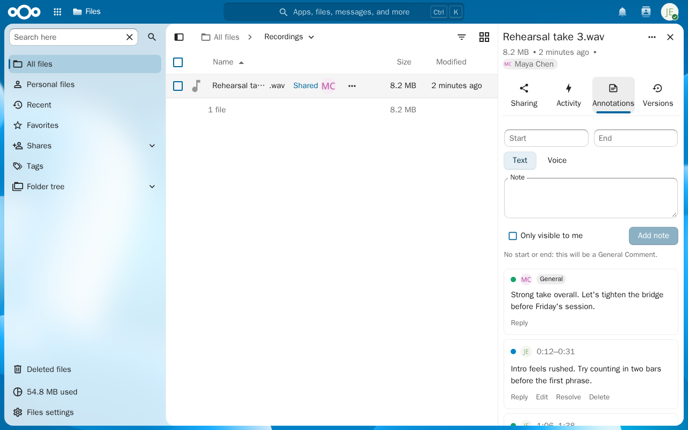
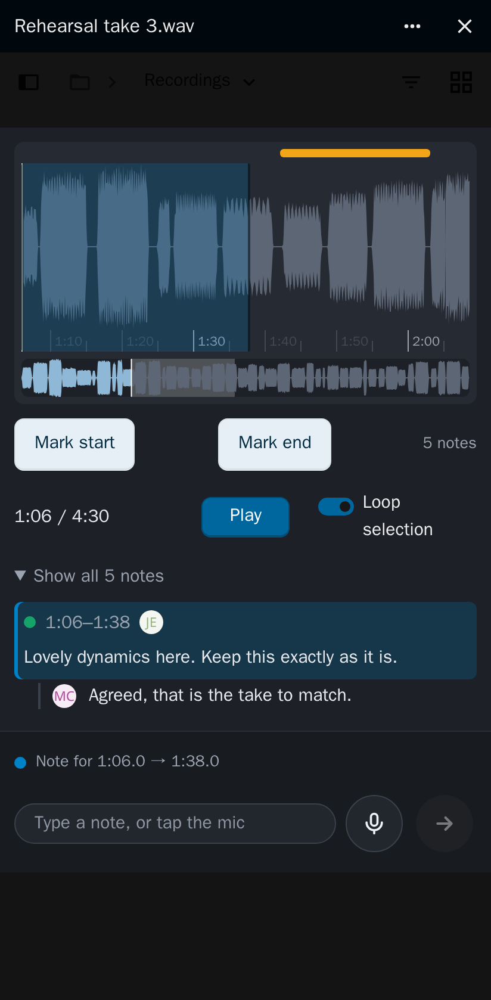
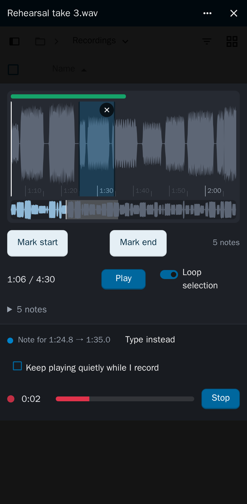

# Audio Annotations

Review recordings in Nextcloud. Highlight part of an audio file and leave a text or voice note on it,
or a general comment on the whole recording. Everyone the file is shared with can read the notes,
reply and mark them resolved.

## How it looks

**Highlight a range and write a note.** Drag across the waveform, or press Mark start and Mark end
while it plays. The box at the bottom saves the note for that range.

**Read a note and its replies.** Tap a note's bar or its line in the list to jump there and show it
with its replies.

**In the Files sidebar.** The Annotations tab lists the same notes, with replies, edit, resolve,
delete and export to Markdown or an Audacity label track.

**On a phone.** Pinch to zoom, use the overview strip to move around, and record voice notes with
the microphone.

  
  

## Requirements

- Nextcloud 33 to 35
- `ffmpeg` and `ffprobe` on the server, and background jobs running through cron
- HTTPS for recording voice notes

## Install

1. Download `audioannotations-<version>.tar.gz` from the [releases](https://github.com/corbindk/audioannotations/releases).
2. Unpack it into your Nextcloud's `custom_apps` folder.
3. Enable it: `sudo -u www-data php occ app:enable audioannotations`.

## More

- [How it works](docs/how-it-works.md): storage, background jobs and the API
- [Development](docs/development.md): building, checks and tests
- License: AGPL-3.0-or-later ([LICENSES](LICENSES/AGPL-3.0-or-later.txt))
